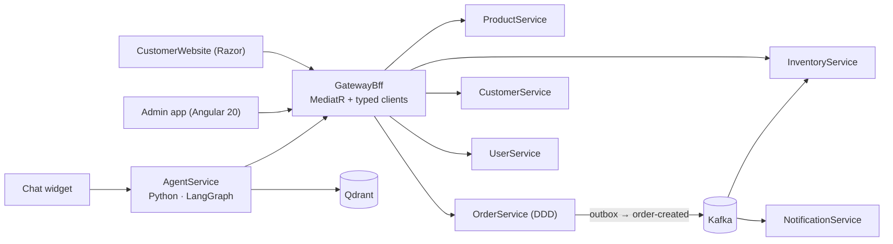

# DistributedOrderSystem

A distributed e-commerce backend built as a set of .NET 10 microservices, with an AI customer-support agent (Python / LangGraph) on top. It's a personal project I use to design and test production-grade patterns end to end: service boundaries, event-driven consistency, a BFF gateway and LLM-based agents working on real backend data.

## Architecture



| Service | Responsibility | Storage / tech |
|---|---|---|
| **GatewayBff** | Single entry point for the frontends; MediatR commands/queries over typed `HttpClient`s | stateless |
| **Admin app** | Back-office for managing products, inventory and orders; talks only to the GatewayBff | Angular 20, standalone components + Signals, SSR |
| **OrderService** | Order lifecycle — full DDD (aggregate root, value objects, domain events), transactional outbox | PostgreSQL, Kafka producer |
| **ProductService** | Catalog — Clean Architecture + CQRS | PostgreSQL, Redis |
| **InventoryService** | Stock levels, order/inventory saga participant | PostgreSQL, Redis, Kafka consumer |
| **CustomerService** | Cart and wishlist | Redis |
| **UserService** | Authentication — ASP.NET Identity, JWT, Google/Facebook OAuth | PostgreSQL |
| **NotificationService** | Email, SMS and push notifications, background jobs | PostgreSQL, Hangfire, SignalR |
| **PaymentService** | Payment integration (in progress) | PostgreSQL |
| **ChatbotService** | Chat widget backend | PostgreSQL, Redis |
| **AgentService** | AI support/sales agent: intent routing, order lookup and cancellation, appointment scheduling, catalog and checkout | Python, LangGraph, Claude, Qdrant |
| **AppHost** | .NET Aspire orchestration for local development | — |

## Key design decisions

- **Consistency across services:** orders are written together with an outbox record in the same transaction and published to Kafka afterwards; an order/inventory saga handles compensation (stock release) when a step fails.
- **DDD where the domain is richest:** OrderService enforces its state transitions inside value objects and only exposes factory methods; simpler services use lighter layering.
- **One gateway for the frontends:** the website never calls a service directly — everything goes through GatewayBff.
- **Grounded AI agent:** the LLM only formats data it was given. Routing decisions are plain functions, testable without network calls.
- **Hybrid RAG for order history:** BM25 + vector search fused with Reciprocal Rank Fusion, HyDE query expansion and a reranker, with a RAGAS-based quality gate in CI.
- **Pluggable connectors:** the agent talks to order, scheduling (Google Calendar, Microsoft Graph, Calendly), catalog and checkout backends through small interfaces, with secrets in Azure Key Vault.

## Tech stack

.NET 10 · ASP.NET Core · EF Core 10 · PostgreSQL · Redis · Kafka (KRaft) · MediatR · Hangfire · SignalR · .NET Aspire · Docker · Python · FastAPI · LangGraph · Anthropic Claude · Qdrant · Voyage AI · GitHub Actions

## Running locally

Prerequisites: .NET 10 SDK, Docker, Python 3.12.

```bash
# Infrastructure (PostgreSQL, Redis, Kafka, Kafka UI)
docker compose -f docker/docker-compose.yml up -d

# UserService doesn't have an appsettings.Development.json override for its
# DB connection string, JWT secret or encryption key — set them once via
# user-secrets before running it locally:
cd src/UserService
dotnet user-secrets init
dotnet user-secrets set "ConnectionStrings:DefaultConnection" "Host=localhost;Port=5432;Database=UserServiceDb;Username=postgres;Password=YourStrong_Password123;"
dotnet user-secrets set "Jwt:Secret" "<a-strong-random-secret-at-least-32-chars>"
dotnet user-secrets set "Encryption:Key" "<32-character-key>"
dotnet user-secrets set "Encryption:IV" "<16-character-iv>"
cd ../..

# All .NET services via Aspire
dotnet run --project src/AppHost

# Admin app (products, inventory, orders)
cd src/frontend/distributed-order-app && npm install && npm start

# AI agent
cd src/AgentService
pip install -r requirements.txt
cp .env.example .env   # add your API keys
uvicorn main:app --reload
```

Connection strings in `appsettings.Development.json` point to the local Docker containers and are for development only. The base `appsettings.json` files (used outside Development) ship with empty values for `ConnectionStrings:ProductDb`, `ConnectionStrings:InventoryDb`, `ConnectionStrings:ChatbotDb` and `Auth:SecretKey` (ChatbotService) — each service fails fast on startup with a clear error if they aren't supplied via user-secrets or environment variables.

## Tests

```bash
dotnet test DistributedOrderSystem.sln
cd src/AgentService && pytest            # unit tests
cd src/AgentService && pytest -m rag_eval  # RAG quality gate (calls the LLM)
```

`dotnet test` includes `tests/OrderService.Tests` (Order aggregate and status transitions), `tests/InventoryService.Tests` (stock adjustment and cache-aside reads) and `tests/ProductService.Tests` (validators, command/query handlers).

## Roadmap

- Integration tests (Testcontainers) for the .NET services
- Complete PaymentService with a real payment provider
- Distributed tracing with OpenTelemetry across services and the agent
- Dead-letter handling and retry policies for Kafka consumers
- Kubernetes manifests / Helm chart
